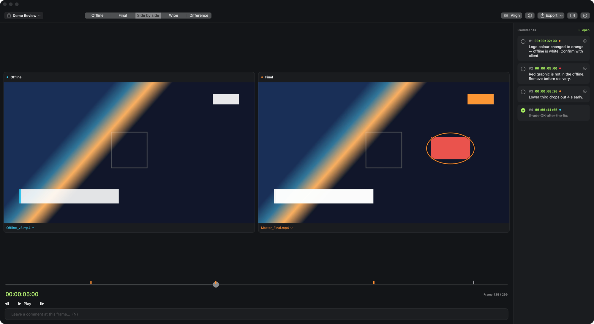
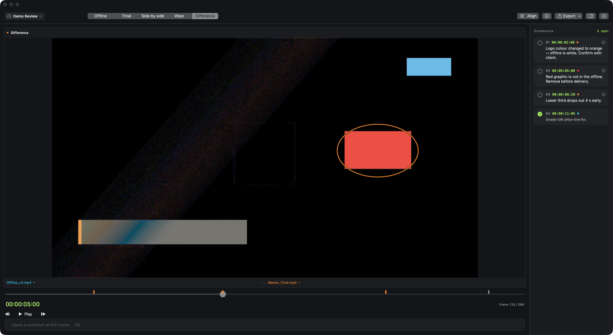
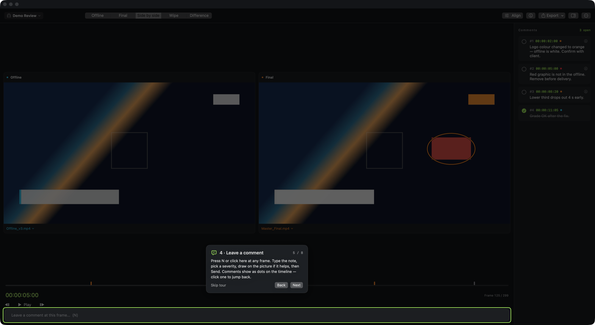

<h1 align="center">FRAMECHECK</h1>

<p align="center"><b>เทียบ offline กับ final master ทีละเฟรม · จด comment · ส่งกลับเป็น marker ใน Final Cut Pro</b><br>
<sub>Compare an offline reference with the final master, frame by frame — then hand notes back as FCP markers.</sub></p>

<p align="center">
  <a href="https://github.com/dankantapat-lab/framecheck-releases/releases/latest/download/FRAMECHECK.zip"></a><br>
  <sub>macOS 14 ขึ้นไป · ชิป M และ Intel · <a href="../../releases">เวอร์ชันทั้งหมด</a></sub>
</p>

<p align="center"></p>

## ทำอะไรได้

| | |
|---|---|
| **Wipe** — ลากเส้นแบ่งบนภาพ ซ้าย Offline ขวา Final |  |
| **Diff** — จุดไหนต่างจาก offline จะสว่างขึ้นมา เห็นทันทีว่ากราฟิกหาย เกิน หรือเปลี่ยนสี |  |
| **Comment แบบ Frame.io** — กด `N` ที่เฟรมไหนก็ได้ พิมพ์ เลือกความรุนแรง วาดวงบนภาพ comment ขึ้นเป็นจุดบน timeline |  |

- **Export** comment เป็น Final Cut Pro markers (`.fcpxml`) · PDF พร้อมภาพนิ่ง · Excel · CSV
- **Align** — ตัดหัวท้ายหรือเลื่อน offset ถ้า final เริ่มไม่ตรงกับ offline
- **หลายคู่ในรีวิวเดียว** — จับ offline ตัวไหนเทียบกับ final ตัวไหนก็ได้ เปลี่ยนคู่แล้ว playhead อยู่ที่เดิม
- **คีย์ลัดตั้งเองได้** (`⌘,`) · มี tutorial ตอนเปิดครั้งแรก · แอปเช็คเวอร์ชันใหม่ให้เอง

## ติดตั้ง

1. กดปุ่ม **Download for Mac** ด้านบน แล้วแตกไฟล์ zip
2. ลาก `FRAMECHECK.app` ไปไว้ในโฟลเดอร์ **Applications**
3. เปิดครั้งแรก Mac จะเตือนว่าเช็คแอปไม่ได้ (แอปไม่ได้ลงทะเบียนกับ Apple — ไม่ใช่ไวรัส) → ไปที่ **System Settings › Privacy & Security** → กด **Open Anyway**

ถ้าไม่มีปุ่ม Open Anyway ให้วางคำสั่งนี้ใน Terminal แล้วเปิดแอปใหม่:

```bash
xattr -cr /Applications/FRAMECHECK.app
```

## อัปเดต

แอปเช็คเวอร์ชันใหม่ตอนเปิด ถ้ามีจะขึ้นแถบ **"FRAMECHECK x.x is available"** → กด **Download** → ปิดแอป → ลากตัวใหม่ทับใน Applications รีวิวและคีย์ลัดไม่หาย

## คีย์ลัด

| คีย์ | | คีย์ | |
|---|---|---|---|
| `Space` | เล่น / หยุด | `N` | comment ที่เฟรมนี้ |
| `Tab` | สลับ Offline ↔ Final | `←` `→` | ทีละเฟรม (`⇧` = 10) |
| `W` | วน Side by side → Wipe → Diff | `⌘\` | เปิด / ปิดช่อง comment |

---

<sub>repo นี้มีแค่ไฟล์ติดตั้ง ไม่มี source code · ภาพตัวอย่างใช้ฟุตเทจสังเคราะห์</sub>
