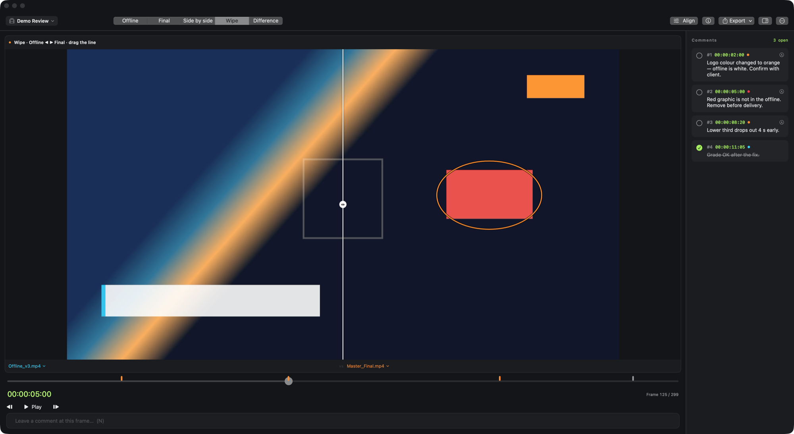

<h1 align="center">FRAMECHECK</h1>

<p align="center"><b>Compare your offline with the final master, frame by frame.</b><br>
Leave comments on the picture, then hand them back as Final Cut Pro markers or a PDF report.</p>

<p align="center">
  <a href="https://github.com/dankantapat-lab/framecheck-releases/releases/latest/download/FRAMECHECK.zip"></a><br>
  <sub>macOS 14 or later · Apple Silicon and Intel · <a href="../../releases">All versions</a></sub>
</p>

<p align="center"></p>

## What it does

| | |
|---|---|
| **Wipe**: drag a line across the picture, with the offline on the left and the final on the right. |  |
| **Diff**: anything that changed from the offline lights up, so a missing, extra or recoloured graphic is easy to spot. |  |
| **Comments**: press `N` on any frame, type a note, set how serious it is and draw on the picture. Every comment shows as a mark on the timeline. |  |

- **Export** comments as Final Cut Pro markers (`.fcpxml`), a PDF report with stills, Excel or CSV.
- **Align**: trim heads and tails or shift the offset when the final starts at a different point.
- **Many pairs in one review**: compare any offline with any final. The playhead stays put when you switch pairs.
- **Your own shortcuts** (`⌘,`), a tutorial on first launch, and built-in update checks.

## Install

1. Click **Download for Mac** above and unzip the file.
2. Drag `FRAMECHECK.app` into your **Applications** folder.
3. The first time you open it, macOS warns that it can't check the app, because FRAMECHECK isn't registered with Apple. It is not malware. Go to **System Settings › Privacy & Security** and click **Open Anyway**.

If there is no **Open Anyway** button, run this in Terminal and open the app again:

```bash
xattr -cr /Applications/FRAMECHECK.app
```

## Update

FRAMECHECK checks for a new version when it opens. When one is out, a bar says **"FRAMECHECK x.x is available"**. Click **Download**, quit FRAMECHECK, unzip the new version and drag it into Applications (choose **Replace**). macOS asks you to approve it again, as in step 3 above. Your reviews and shortcuts are kept.

## Feedback

Found a bug or have an idea? Choose **Help › Send Feedback…** in the app, write your message (any language is fine) and click **Open in Email App**, then send the email. If no email appears (for example, you use Gmail in a browser), click **Copy Message** and email it to the address shown.

## Keyboard shortcuts

| Key | | Key | |
|---|---|---|---|
| `Space` | Play / pause | `N` | Comment at this frame |
| `Tab` | Swap Offline ↔ Final | `←` `→` | Step one frame (`⇧` = 10) |
| `W` | Cycle Side by side → Wipe → Diff | `⌘\` | Show / hide comments |

---

<sub>This repository holds installers only; there is no source code here. The screenshots use synthetic demo footage.</sub>
